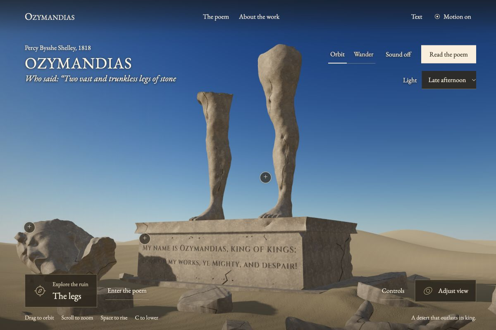

# Ozymandias

A poem to walk through.

[Enter the world](https://mihirduvedi.github.io/ozymandias/)

Ozymandias turns Shelley's fourteen-line poem into a place you can explore. Two
broken legs rise above a half-buried pedestal, a fallen face still wears its
sneer, and the inscription looks out over an empty desert. You can follow a guided
reading through the ruin or find your own way around it.



[Watch the tour highlights](https://mihirduvedi.github.io/ozymandias/watch.html)

## Read it your way

Choose **Enter the poem** to follow all fourteen lines automatically. The camera
travels from a visitor's arrival to the fragments, the inscription, and a wide
view of the surrounding sands. Pause, go back, or skip ahead whenever you like.
Moving the camera yourself pauses the tour.

For free exploration, use **Orbit** to circle the statue or **Wander** to move
through the desert. A plus beside part of the ruin opens the lines that describe
it. Selecting a line in the poem takes you back to that part of the world.
Ordinary clicks keep you in the scene.

The full poem and **Text only** view preserve Shelley's wording, punctuation,
line breaks, and alignment. Long lines scroll sideways on a narrow screen.
Motion can be turned off, and the interface honors the device's reduced-motion
setting. Sound is optional and starts only when you select it.

## Controls

| Action | Control |
| --- | --- |
| Circle the statue in Orbit | Click and drag |
| Move in Wander | WASD or click and drag |
| Look around in Wander | Arrow keys or Alt + drag |
| Pan | Right-click and drag, Shift + drag, or Shift + arrows |
| Zoom | Scroll, pinch in Orbit, or + and − |
| Rise | Space or Page Up |
| Lower your view | C, Shift + Space, or Page Down |
| Move faster in Wander | Hold Shift |
| Open a focused marker | Tab, then Enter |
| Close a dialog, menu, or tour | Escape |

Focus the world before using its keyboard controls. The **Controls** panel lists
these mappings, and **Adjust view** provides buttons for moving the camera.
Travel is limited to 160 meters from the statue and 75 meters above the ground.

## Run locally

Node 24 is the tested version. No account, API key, or backend is needed.

```sh
npm ci --ignore-scripts
npm run dev -- --port 5173
```

Open http://127.0.0.1:5173/.

For a production preview:

```sh
npm run build
npm run preview -- --port 4173
```

Open http://127.0.0.1:4173/. Links such as `#/ozymandias/O04` select a line;
`#/ozymandias/plain` opens the text-only reader. The app also works beneath a
hosting subdirectory, including the GitHub Pages URL above.

## How it's built

React and TypeScript handle reading state and the interface. Three.js renders
the terrain, sculpture, sky, sunlight, shadows, and blowing sand. The scene is
real geometry that you can move through. Photographed sand and stone maps give
its surfaces detail, and the camera follows a continuous route during the tour.

The legs, feet, and hand use prepared anatomical meshes. The head comes from a
credited scan of Ramesses II, cropped and reshaped to bring out the expression
in the poem. Broken surfaces, cracks, and sand burial were added to the ruin.
These are artistic approximations of erosion and settling, rather than a full
physics simulation or an archaeological reconstruction.

All interface and poem text uses EB Garamond. Cinzel remains in the carved
inscription. The optional sound is a softly mixed, filtered air recording with
long crossfades. Runtime assets are included in the repository and load from
the same host as the app.

`src/world` contains rendering, camera, navigation, sand, and sound code.
`src/content/ozymandias.json` holds the canonical poem. `src/components` contains
the world interface and reading panels. `public/world` holds the prepared models,
textures, sound, and their provenance. Asset preparation scripts are in `scripts`;
they aren't needed to run the app.

The source also preserves an unfinished Second Coming experiment. It is hidden
from the published interface and is outside this hackathon entry.

## Check the project

```sh
npm test -- --maxWorkers=2 --testTimeout=30000
npm run lint
npm run build
```

Tests cover the canonical text, reading state, tour, camera continuity,
navigation, sculpture geometry, sand settling, and audio lifecycle. The longer
timeout allows the detailed mesh checks to finish on a busy machine.

The GitHub Actions workflow runs those checks before publishing the built site
to GitHub Pages. [Verification notes](docs/QA.md) distinguish browser checks from
physical-device or screen-reader testing.

## Hackathon materials

This is the Ozymandias entry for Hyperbloom October: UI/UX and Web Design.
The [submission folder](docs/submission) contains the project story, reviewed
requirements, screenshots, a short video, and a demo walkthrough. [Design notes](docs/DESIGN.md)
explain the visual choices, and [interface copy](docs/UI_COPY.md) records the
humanized text used in the app.

AI-assisted tools were used for implementation, research, and iteration.
The [asset credits](docs/ASSET_PROVENANCE.md) identify the outside work used in
the scene, and [third-party notices](THIRD_PARTY_NOTICES.md) explain its licenses.

Original project code is available under the [MIT License](LICENSE).
Third-party assets retain their own licenses. Shelley's poem is public domain.
